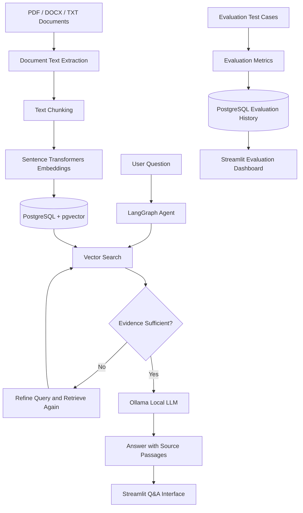

# System Architecture

## Main Components

- **Streamlit:** User interface and evaluation dashboard.
- **PostgreSQL + pgvector:** Stores document chunks and vector embeddings.
- **Sentence Transformers:** Converts text into embeddings for semantic search.
- **LangGraph:** Orchestrates retrieval, evidence assessment, and query refinement.
- **Ollama:** Runs the local language model.
- **Evaluation module:** Tests answer quality, retrieval behavior, and abstention.
